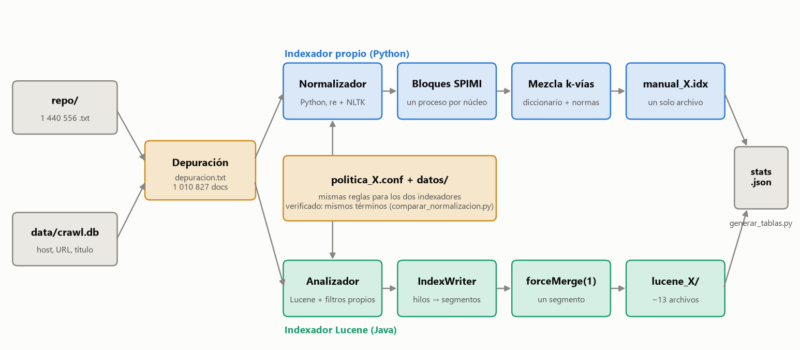
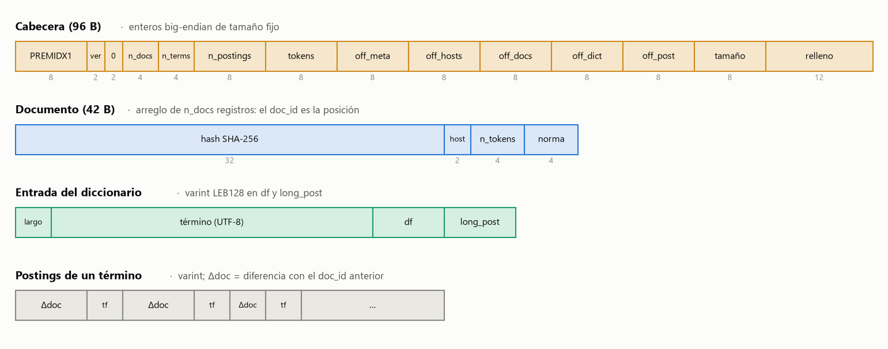
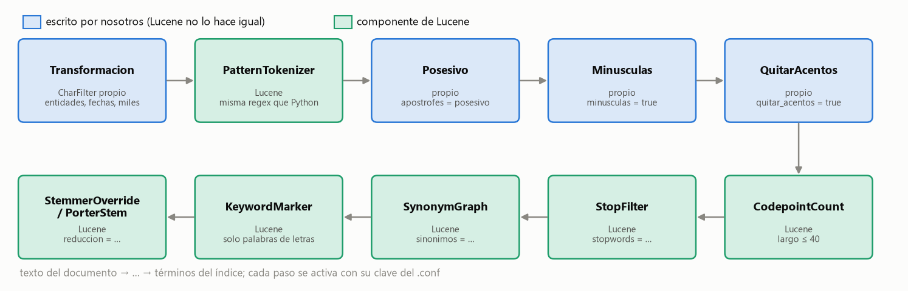
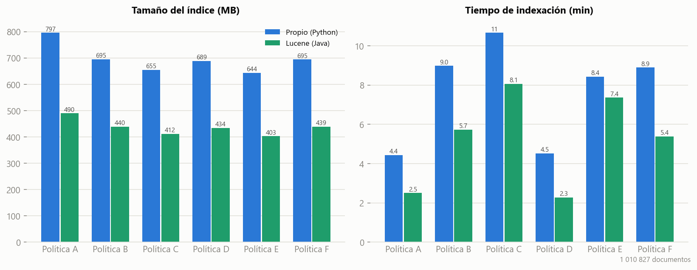
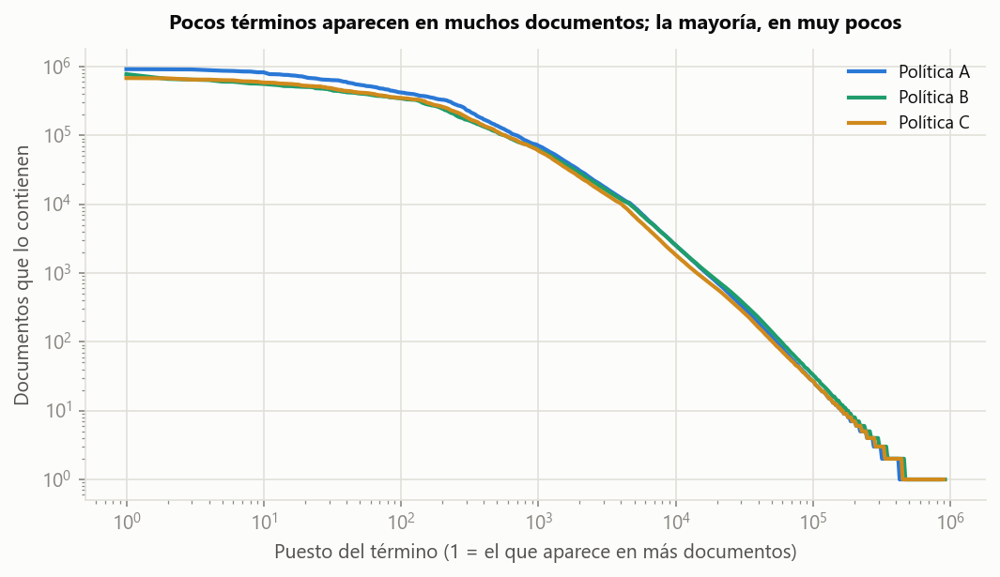

<div align="center">

**Instituto Tecnológico de Costa Rica**  
Escuela de Ingeniería en Computación  
IC8060 – Recuperación de Información Textual  
II Semestre, 2026

# ThePremArchive
### Sistema de Recuperación de Información sobre la Premier League
**Proyecto 2 – Construcción de Índices de Búsqueda**


**Profesor:** Aurelio Sanabria Rodríguez

**Integrantes:**  
Daniel de Jesús Alemán Ruiz – 2023051957  
Sebastián Rodríguez Sánchez – 2023074446

**Fecha de entrega:** Noviembre, 2026

</div>

---

## 1. Introducción

Con el arañador del proyecto anterior recolectamos **1 440 556 documentos** de texto sobre la Premier League (unos **16.2 GB**). Para poder buscar en ellos sin leer toda la colección cada vez, construimos un índice basado en la frecuencia de las palabras (TF-IDF) y en qué tan largo es cada documento.

Como pide el proyecto, lo implementamos de **dos formas** independientes a la araña:

1. **Un indexador propio** en Python, que guarda todo el índice en un único archivo binario diseñado por nosotros.
2. **Un indexador con Apache Lucene** en Java, que aplica exactamente las mismas reglas de limpieza del texto para poder compararlos en igualdad de condiciones.

Ambos programas leen los mismos archivos de configuración (`.conf` y listas en `datos/`), así que cualquier diferencia de tamaño, velocidad o resultados viene de cómo cada herramienta construye y guarda el índice, y no de qué texto está procesando.



*Figura 1. Flujo general: la misma colección y la misma configuración alimentan a los dos indexadores.*

---

## 2. Limpieza previa de la colección

Antes de indexar revisamos qué había realmente en los 16.2 GB de texto y nos encontramos una sorpresa: **Daily Mail representaba solo el 13 % de los documentos, pero ocupaba el 62 % de todo el texto**, y apenas el 7 % de esas páginas era de fútbol. El resto eran noticias generales, política y sucesos muy largos.

Probamos primero filtrar por el conteo de palabras de fútbol que había guardado la araña (`topic_hits`), pero falló para los dos lados: páginas no deportivas del Daily Mail tenían titulares de fútbol en la barra lateral y pasaban el filtro, mientras que notas cortas y válidas de partidos quedaban fuera.

La solución que sí funcionó fue una regla sencilla por sitio y dirección web (URL):

- Los portales especializados en fútbol (Goal, Transfermarkt, Football365, entre otros) entran completos.
- En diarios generalistas solo entran las páginas cuya URL o título indican que son de fútbol.

Con este filtro nos quedamos con **1 010 827 documentos (70 %)**, pero redujimos el texto de **16.2 GB a 5.1 GB (31 %)**. En una muestra inicial de 3 000 documentos el índice bajó de 4.9 MB a 2.0 MB.

> **Costo aceptado:** al probar 15 consultas, 6 de los 150 resultados que aparecían antes en los primeros 10 puestos quedaron fuera (principalmente perfiles de jugadoras de fútbol femenino que mencionan pocas palabras clave del filtro). Aceptamos este sesgo porque limpia la mayor parte del ruido y reduce el tamaño final del índice en un **62 %** y el tiempo en un **68 %**.

---

## 3. Políticas de normalización

Normalizar significa llevar palabras escritas distinto a una forma común (por ejemplo, que `Arsenal's`, `arsenal` y `Arsenal` cuenten como la misma palabra). Preparamos **seis políticas**:

- **A, B y C** son las tres políticas principales que entregamos, de menor a mayor procesamiento.
- **D, E y F** cambian **una sola regla** respecto a otra política para medir por separado el efecto real de cada decisión.

| Paso aplicado al texto | A (base) | B | C | D | E | F |
|---|:---:|:---:|:---:|:---:|:---:|:---:|
| Minúsculas y separar palabras | ✔ | ✔ | ✔ | ✔ | ✔ | ✔ |
| Quitar posesivos (`Arsenal's` → `arsenal`) | — | ✔ | ✔ | — | ✔ | ✔ |
| Quitar acentos (`Atlético` → `atletico`) | — | ✔ | ✔ | — | ✔ | ✔ |
| Quitar palabras vacías (*stopwords*) | — | ✔ | ✔ | ✔ | ✔ | ✔ |
| Unificar fechas y números (`May 6, 2010` → `2010-05-06`) | — | ✔ | ✔ | — | ✔ | ✔ |
| Sinónimos (`soccer` → `football`) | — | — | ✔ | — | ✔ | ✔ |
| Clubes y torneos (`Man City` → `manchester_city`) | — | — | ✔ | — | ✔ | — |
| Reducir a palabra base | — | — | lemas | — | Porter | — |
| **Qué evalúa** | base | entrega | entrega | efecto de *stopwords* | *stemming* vs. lemas | efecto de sinónimos |

### Por qué tomamos cada decisión

- **Posesivos:** si simplemente cortamos en el apóstrofe, `Arsenal's` deja una `s` suelta que termina siendo de las palabras más repetidas de toda la colección. Por eso B y C la eliminan.
- **Palabras vacías (*stopwords*):** son palabras muy comunes como *the* o *and* que no ayudan a distinguir documentos. Partimos de la lista en inglés de NLTK (Bird, Klein y Loper, 2009), de 159 palabras tras ajustarla al fútbol: sacamos de la lista `won`, `will`, `can` y `may` porque en este tema sí importan (ganar, el mes de mayo, o nombres como *Will Keane* y *Emre Can*; con la lista original buscar `Will Keane goals` devolvía a *Michael Keane*). También verificamos que no hubiera nombres de países.
- **Fechas y números:** `May 6, 2010` y `6/5/2010` pasan a `2010-05-06` (usando orden británico día/mes), y `1,234` pasa a `1234`, para que una fecha cuente igual sin importar cómo esté escrita.
- **Sinónimos:** usamos una lista corta y segura (`soccer` → `football`, `goalie` → `goalkeeper`, `ref` → `referee`). Dejamos fuera pares como `manager` y `coach` porque en el fútbol inglés no siempre significan lo mismo.
- **Clubes y competiciones:** unimos los nombres y apodos principales de clubes y torneos en un solo término (`manchester_city`, `premier_league`, `world_cup`), excluyendo apodos ambiguos como `Citizens`. Al principio intentamos unir cualquier frase con mayúsculas (como `Harry Kane`), pero salió mal: la gente busca en minúsculas y luego la consulta no coincidía con el índice.
- **Tesauro:** la lista de sinónimos y la de clubes con sus apodos hacen de tesauro sencillo: cada término preferido (`football`, `manchester_city`) agrupa a sus variantes. No tiene relaciones de "término más general" o "más específico", porque para esta colección no las necesitamos.
- **Lemas contra *stemming* (raíces):** ambos agrupan variantes de una palabra (`injuries` → `injury`). Para lemas (C) aplicamos solo terminaciones regulares en palabras frecuentes (al menos 20 apariciones), porque el diccionario WordNet (Fellbaum, 1998) cometía errores en fútbol (por ejemplo `boss` → `bos`). Para *stemming* (E) usamos el algoritmo clásico de Porter (Porter, 1980), que es más rápido aunque a veces recorta de más (`news` → `new`).

---

## 4. El índice propio

El indexador propio sigue el esquema clásico TF-IDF (Manning, Raghavan y Schütze, 2008): una palabra suma más peso cuanto más aparece en un documento, pero vale menos si sale en casi todos los documentos de la colección. En concreto, el peso de una palabra en un documento es `(1 + log10 tf) · log10(N / df)`, y consulta y documento se comparan con el coseno entre sus vectores (Salton y Buckley, 1988). Así se toma en cuenta el largo de cada documento para no darle ventaja automática a artículos larguísimos solo por repetir palabras.

Para construir el índice sin llenar la memoria RAM, varios procesos leen documentos en paralelo, guardan partes ordenadas en disco y al final las unen en un solo archivo (la estrategia conocida como SPIMI; Heinz y Zobel, 2003). Además, guarda su avance en archivos temporales antes de renombrarlos, así que si el programa se detiene a mitad de camino puede continuar donde se quedó sin perder trabajo.

### 4.1 Estructura interna del archivo (`.idx`)

Todo el índice vive en **un solo archivo binario**, dividido en seis secciones seguidas:

```text
+----------+-----------+--------+------------+-------------+------------+
| Cabecera | Metadatos | Sitios | Documentos | Diccionario | Apariciones|
| 96 bytes | config    | web    | 42 bytes   | palabras    | por palabra|
|          |           |        | cada uno   | ordenadas   | (postings) |
+----------+-----------+--------+------------+-------------+------------+
```

| Sección | Qué guarda |
|---|---|
| **Cabecera** | La firma `PREMIDX1`, versión, cantidad de documentos y palabras, y la posición exacta donde empieza cada sección. |
| **Metadatos** | Copia de la configuración `.conf` usada, para saber qué política generó el archivo. |
| **Sitios (Hosts)** | Lista de sitios web de origen, para guardar un número corto en vez de repetir el dominio en cada documento. |
| **Documentos** | Registro fijo de 42 bytes por documento: su identificador único (hash), sitio, cantidad de palabras y factor de largo. |
| **Diccionario** | Lista ordenada de todas las palabras distintas, en cuántos documentos sale cada una y cuánto ocupa su lista de apariciones. |
| **Apariciones (Postings)** | Para cada palabra, la lista de documentos donde aparece y cuántas veces se repite en cada uno. |



*Figura 2. Detalle de los campos de cada sección; los números debajo indican su tamaño en bytes.*

Para que el archivo ocupe poco espacio usamos dos trucos sencillos:
1. En las apariciones no guardamos el número completo de cada documento, sino **la diferencia respecto al documento anterior** (números mucho más chicos).
2. Esos números se guardan con **tamaño variable** (la codificación LEB128; DWARF Debugging Information Format Committee, 2017): cualquier número menor a 128 ocupa solo **1 byte**. Gracias a esto, cada aparición ocupa en promedio **2.3 bytes**.

### 4.2 Inspección con `hexdump -C`

Como la cabecera indica en qué byte empieza cada sección, se puede consultar las posiciones con el comando `info` y abrir cualquier parte directamente con `hexdump -C`:

```bash
python -m indexacion.indexador_manual info indices/manual_A.idx
hexdump -C -s <posicion> -n 64 indices/manual_A.idx
```

Por ejemplo, así empiezan los primeros 32 bytes de un índice de prueba de 3 000 documentos:

```text
00000000  50 52 45 4d 49 44 58 31  00 01 00 00 00 00 0b b8  |PREMIDX1........|
00000010  00 01 69 00 00 00 00 00  00 1c 61 40 00 00 00 00  |..i.......a@....|
```

- `50 52 45 4d 49 44 58 31` → firma `PREMIDX1`.
- `00 01` → versión 1 del formato (seguida de 2 bytes reservados en cero).
- `00 00 0b b8` → 3 000 documentos.
- `00 01 69 00` → 92 416 palabras distintas.
- `00 00 00 00 00 1c 61 40` → 1 860 928 apariciones (postings).

---

## 5. Indexador con Apache Lucene

El segundo indexador está hecho en Java (`indexacion/indexador_lucene/`) sobre **Apache Lucene 9.12.3**. Escogimos Java directamente porque los puentes desde Python complican la instalación y no permiten escribir fácilmente filtros personalizados compatibles con nuestras políticas.

Las principales decisiones en Lucene fueron:

| Aspecto | Qué elegimos | Por qué |
|---|---|---|
| Versión | Lucene 9.12.3 | Funciona con Java 17 (Lucene 10 exige Java 21). |
| Datos por palabra | Solo documento y frecuencia (`DOCS_AND_FREQS`) | No guardamos posiciones exactas de cada palabra porque no hacemos búsquedas por frase exacta, y eso ahorra mucho espacio (Apache Software Foundation, 2024a). |
| Datos por documento | Hash y sitio comprimidos | Lo mínimo para identificar el documento en pantalla, equivalente al registro de 42 bytes del índice propio. |
| Fórmula de puntaje | `ClassicSimilarity` | Usa el modelo TF-IDF clásico en vez de BM25 (el predeterminado de Lucene) para poder comparar bajo la misma familia de puntaje (Apache Software Foundation, 2024b). |
| Construcción y cierre | Varios hilos y fusión final (`forceMerge(1)`) | Cada hilo arma partes en memoria y al final se unen en un solo segmento comparable con nuestro archivo único (Apache Software Foundation, 2024c). |



*Figura 3. Cadena de normalización en Lucene: donde sus filtros nativos hacían algo distinto a Python (fechas, posesivos, acentos o mayúsculas), escribimos filtros propios para garantizar exactamente el mismo resultado.*

### Verificación de equivalencia

Escribimos un script (`comparar_normalizacion.py`) para verificar que ambos indexadores produjeran **exactamente lo mismo**. Tras corregir pequeñas diferencias de texto y de algoritmo (por ejemplo, cambiar al algoritmo oficial de Porter en Python), comprobamos sobre los **1 010 827 documentos** de las seis políticas que ambos generan **los mismos documentos, las mismas palabras distintas y exactamente las mismas frecuencias**.

Al correr Lucene en otra computadora también ajustamos la forma en que Java recorre los archivos de la carpeta (bajando el listado de 80 s a ~4 s) para que su tiempo refleje solo el trabajo de indexar y no la lectura del disco.

---

## 6. Estadísticas de los índices

Todas las cifras corresponden a la colección limpia (**1 010 827 documentos**). Como ambos indexadores procesan exactamente las mismas palabras y apariciones, esas columnas son compartidas.

**Tabla 1. Resultados por política en ambos indexadores**

| Política | Palabras totales | Palabras distintas | Apariciones (postings) | Tamaño propio | Tamaño Lucene | Tiempo propio | Tiempo Lucene |
|---|---|---|---|---|---|---|---|
| **A (base)** | 900 360 645 | 847 186 | 353 851 101 | 796.6 MB | 489.7 MB | 4 min 26 s | 2 min 31 s |
| **B** | 602 639 609 | 914 759 | 301 803 447 | 695.4 MB | 439.6 MB | 8 min 59 s | 5 min 44 s |
| **C** | 591 966 960 | 895 060 | 284 645 208 | 655.2 MB | 411.5 MB | 10 min 40 s | 8 min 04 s |
| **D (A + stopwords)** | 609 442 978 | 847 027 | 300 254 717 | 689.3 MB | 434.3 MB | 4 min 31 s | 2 min 16 s |
| **E (C con Porter)** | 591 966 960 | 831 032 | 280 784 995 | 644.1 MB | 403.1 MB | 8 min 26 s | 7 min 22 s |
| **F (B + sinónimos)** | 602 639 609 | 914 752 | 301 555 100 | 694.9 MB | 439.3 MB | 8 min 54 s | 5 min 23 s |



*Figura 4. Comparación visual de tamaño y tiempo de construcción para las seis políticas.*

**Sobre los tiempos:** cada uno es de una sola corrida, en un computador de escritorio, y tienen ruido. El indexador propio tardó 8 min 57 s en una corrida de la política C y 10 min 40 s en otra, así que diferencias de hasta un 20 % no son confiables. Los tiempos del propio en B, C, E y F son de una segunda corrida (reconstruimos esos índices al corregir dos detalles de normalización); los demás vienen de la corrida en que se construyeron los dos indexadores seguidos.

**Tabla 2. Impacto de cada decisión por separado (indexador propio)**

| Comparación | Qué mide | Palabras distintas | Apariciones | Tamaño | Tiempo |
|---|---|---|---|---|---|
| **D vs. A** | Quitar *stopwords* | ≈ 0 % | -15 % | -13 % | +2 % |
| **E vs. C** | *Stemming* (Porter) vs. lemas | -7 % | -1 % | -2 % | -21 % |
| **F vs. B** | Agregar sinónimos | ≈ 0 % | ≈ 0 % | ≈ 0 % | -1 % |
| **A vs. sin limpiar** | Depurar el ruido inicial | -35 % | -64 % | -62 % | -68 % |

### Cómo es la colección indexada

Para caracterizar lo que se puede buscar, calculamos cómo son los documentos y las palabras de cada índice (con `estadisticas_extra.py`).

| Política | Palabras por documento (media / mediana) | Palabras que salen en un solo documento | Apariciones que ocupan las 100 palabras más comunes |
|---|---|---|---|
| **A (base)** | 891 / 655 | 50 % | 16 % |
| **B** | 596 / 411 | 49 % | 14 % |
| **C** | 586 / 403 | 50 % | 16 % |
| **D** | 603 / 413 | 50 % | 15 % |
| **E** | 586 / 403 | 50 % | 16 % |
| **F** | 596 / 411 | 49 % | 14 % |



*Figura 5. Cuántos documentos contienen cada palabra, ordenadas de la más a la menos común (escala logarítmica). Las tres políticas se parecen mucho.*

- **La mitad del vocabulario aparece en un solo documento**, por ejemplo nombres raros, errores de escritura o palabras en otros idiomas. Pocas palabras salen en muchos documentos y casi todas salen en muy pocos, que es el patrón típico de los textos (Manning, Raghavan y Schütze, 2008).
- **Sin *stopwords* (política A), las palabras más comunes son las vacías:** `to` está en el 91 % de los documentos, `a` en el 90 %, `the` en el 90 % y `s` en el 82 %. Con ellas fuera (política B) las más comunes pasan a ser del tema, como `league` (77 %), `season` (63 %), `team` (60 %) y `club` (56 %), junto con palabras que probablemente vienen de las plantillas de los sitios, como `content` (64 %) y `site` (60 %).
- **El documento típico es corto:** la mediana es de unas 400 palabras después de limpiar y casi ninguno tiene menos de 100.

### Velocidad de búsqueda

También medimos cuánto tarda cada indexador en abrir un índice y en responder las 12 consultas de prueba (con `medir_consultas.py`). La consulta incluye normalizarla, buscar los 10 mejores resultados y leer su identificador, con el índice ya abierto. Cada consulta se repite 7 veces después de una pasada de calentamiento y se toma la mediana.

| Política | Apertura propio | Apertura Lucene | Consulta propio (mediana / máxima) | Consulta Lucene (mediana / máxima) |
|---|---|---|---|---|
| **A** | 800 ms | 4.6 ms | 107 ms / 234 ms | 4.5 ms / 17 ms |
| **B** | 1.5 s | 5.0 ms | 147 ms / 211 ms | 4.8 ms / 11 ms |
| **C** | 985 ms | 7.9 ms | 87 ms / 222 ms | 5.2 ms / 13 ms |
| **D** | 1.0 s | 5.0 ms | 119 ms / 194 ms | 4.9 ms / 16 ms |
| **E** | 945 ms | 3.9 ms | 100 ms / 238 ms | 7.9 ms / 25 ms |
| **F** | 1.2 s | 4.6 ms | 124 ms / 159 ms | 5.5 ms / 11 ms |

Lucene abre el índice en milisegundos porque no carga el diccionario completo en memoria, y el propio tarda alrededor de 1 segundo en leerlo entero. Además, Lucene responde cada consulta entre 13 y 31 veces más rápido (unos 5 ms contra 90 a 150 ms). La diferencia tiene sentido: el propio calcula el coseno contra el millón de documentos con arreglos de numpy, mientras que Lucene lee solo las apariciones de las palabras de la consulta y puede saltarse bloques. Es una medición en una sola computadora y con consultas cortas; sirve para comparar, no como cifra absoluta.

### Qué nos dicen los números

- **Limpiar la colección es lo que más ahorra:** baja el índice de **2.10 GB a 0.80 GB** y el tiempo de **13.7 a 4.4 minutos**, mucho más que cualquier ajuste de normalización.
- **Las *stopwords* sí ayudan:** reducen el tamaño en un **13 %** sin afectar el tiempo. Los sinónimos casi no mueven el tamaño porque nuestra lista es corta, y cambiar lemas por *stemming* reduce el vocabulario un **7 %**.
- **Lucene comprime más y une más rápido:** ocupa entre **61 % y 63 %** del tamaño del índice propio (~1.4 bytes por aparición contra 2.3) y termina antes en todas las políticas, sobre todo en la unión final de partes (~10 s contra ~2 min). **También responde las consultas mucho más rápido**, de 13 a 31 veces.

---

## 7. Calidad de búsqueda y comparación entre indexadores

Para comprobar si un índice más pequeño sigue encontrando lo que el usuario busca, probamos **12 consultas reales** (como `man city vs man utd`, `soccer transfer deadline day`, `premier league results 5 May 2012` y `liverpool injury news`) en las seis políticas de ambos indexadores. Evaluamos los 10 primeros resultados de cada búsqueda (427 pares en total, calificados con apoyo de IA y revisados a mano en los casos dudosos).

### Dos hallazgos clave en las pruebas

1. **Documento y consulta deben normalizarse igual:** en la prueba de fechas (`premier league results 5 May 2012`), solo las políticas que normalizan fechas (B, C, E y F) encontraron en primer lugar la crónica exacta del partido. Además, cuando uníamos cualquier nombre en mayúsculas, las búsquedas en minúsculas fallaban; restringirlo a la lista de clubes y torneos resolvió el problema y redujo el vocabulario de C a menos de la mitad.
2. **La lematización puede subir páginas vacías si se premian textos cortos:** al buscar `liverpool injury news`, la política C subió páginas de partido muy cortas de Goal.com que solo tenían el título automático *"Injuries and Suspensions: No sidelined players"*. Al convertir `injuries` en `injury`, esas páginas cortas coincidían con la búsqueda y desplazaban artículos más completos en el indexador propio.

### Acierto en los primeros 10 resultados (P@10)

| Política | Acierto propio | Acierto Lucene | Documentos en común (top 10) | Consultas con el mismo documento en el primer puesto |
|---|:---:|:---:|:---:|:---:|
| **A (base)** | 0.49 | 0.49 | 14 % | 1 de 12 |
| **B** | **0.53** | 0.60 | 19 % | 1 de 12 |
| **C** | 0.43 | **0.62** | 16 % | 1 de 12 |
| **D** | 0.52 | 0.60 | 16 % | 1 de 12 |
| **E** | 0.42 | 0.61 | 17 % | 1 de 12 |
| **F** | 0.51 | 0.60 | 18 % | 1 de 12 |

Aunque ambos índices guardan **exactamente las mismas palabras y frecuencias**, solo coinciden en entre **14 % y 19 %** de sus primeros 10 resultados, y el documento que queda en primer lugar es el mismo en una sola de las 12 consultas (por ejemplo, para `haaland goals` con la política B, el propio pone primero una página de Manchester Evening News y Lucene una de Planet Football). Además, el ganador cambia según el motor:

- En el **indexador propio**, la mejor relación tamaño/calidad es la política **B (0.53)**. C y E bajan porque nuestra fórmula normaliza de forma estricta por el largo total del documento y favorece páginas muy cortas (mediana de ~1 KB en los resultados).
- En **Lucene**, que suaviza menos el efecto del largo (mediana de ~3–3.5 KB en resultados), las páginas largas y completas compiten mejor: **C empata en primer lugar (0.62)** siendo además más liviana que B (411.5 MB frente a 439.6 MB).

Para calificar usamos tres criterios. Cuenta el **contenido principal** de la página, no las etiquetas ni las barras laterales. Se califica **por tema y no por fecha**, porque nuestros índices no usan fechas y `this season` o `news` no distinguen una página reciente de una vieja. Y `the league` se tomó como la **Premier League**, así que un arquero que nunca jugó en ella no cuenta. Con 12 consultas, las diferencias de 0.01 o 0.02 entre políticas no se pueden distinguir: con Lucene, B, C, D, E y F quedan juntas entre 0.60 y 0.62, y la única que queda atrás es A.

### Comparación general: Indexador propio vs. Apache Lucene

| Aspecto | Indexador propio | Apache Lucene | En resumen |
|---|---|---|---|
| **Archivos** | Un solo archivo `.idx` ordenado por secciones. | Un conjunto de archivos especializados dentro de un segmento. | El propio es fácil de inspeccionar byte a byte con `hexdump`; Lucene permite agregar documentos nuevos sin rehacer todo. |
| **Compresión** | Diferencias entre documentos y números de tamaño variable (2.3 bytes/aparición). | Empaquetado compacto en bloques de bits y diccionario por prefijos (1.4 bytes/aparición; Lemire y Boytsov, 2015; Apache Software Foundation, 2024d). | Lucene ocupa ~38 % menos disco, abre el índice sin cargar todo el diccionario y responde las consultas entre 13 y 31 veces más rápido (sección 6). |
| **Fórmula de largo** | Exacta sobre todo el documento. | Aproximada en 1 byte por documento. | El propio favorece páginas cortas; Lucene equilibra mejor artículos completos. |
| **Si se interrumpe** | Reanuda desde el último bloque guardado. | Vuelve a empezar de cero. | La reanudación del propio fue muy útil en corridas largas. |
| **Seguridad de datos** | Sin suma de verificación. | Verifica integridad en cada archivo. | Lucene detecta si un archivo del índice se corrompió. |

**Conclusión:** el indexador propio nos permitió entender y controlar cada byte del formato y reanudar indexaciones interrumpidas, mientras que Lucene ofrece menor tamaño, fusiones más rápidas, mejor manejo de artículos largos y detección de errores, a cambio de mayor complejidad para adaptar reglas propias de normalización en Java.

---

## Referencias

- Apache Software Foundation (2024a). *Lucene912PostingsFormat* (documentación de Apache Lucene 9.12). https://lucene.apache.org/core/9_12_0/core/org/apache/lucene/codecs/lucene912/Lucene912PostingsFormat.html
- Apache Software Foundation (2024b). *TFIDFSimilarity* y *ClassicSimilarity* (documentación de Apache Lucene 9.12). https://lucene.apache.org/core/9_12_0/core/org/apache/lucene/search/similarities/TFIDFSimilarity.html
- Apache Software Foundation (2024c). *IndexWriter* (documentación de Apache Lucene 9.12). https://lucene.apache.org/core/9_12_0/core/org/apache/lucene/index/IndexWriter.html
- Apache Software Foundation (2024d). *Lucene90BlockTreeTermsWriter* (documentación de Apache Lucene 9.12). https://lucene.apache.org/core/9_12_0/core/org/apache/lucene/codecs/lucene90/blocktree/Lucene90BlockTreeTermsWriter.html
- Bird, S., Klein, E. y Loper, E. (2009). *Natural Language Processing with Python*. O'Reilly.
- DWARF Debugging Information Format Committee (2017). *DWARF Debugging Information Format, Version 5*, sección 7.6 (codificación LEB128).
- Fellbaum, C. (ed.) (1998). *WordNet: An Electronic Lexical Database*. MIT Press.
- Heinz, S. y Zobel, J. (2003). Efficient single-pass index construction for text databases. *Journal of the American Society for Information Science and Technology, 54*(8), 713–729.
- Lemire, D. y Boytsov, L. (2015). Decoding billions of integers per second through vectorization. *Software: Practice and Experience, 45*(1), 1–29.
- Manning, C. D., Raghavan, P. y Schütze, H. (2008). *Introduction to Information Retrieval*. Cambridge University Press.
- Porter, M. F. (1980). An algorithm for suffix stripping. *Program, 14*(3), 130–137.
- Salton, G. y Buckley, C. (1988). Term-weighting approaches in automatic text retrieval. *Information Processing & Management, 24*(5), 513–523.
