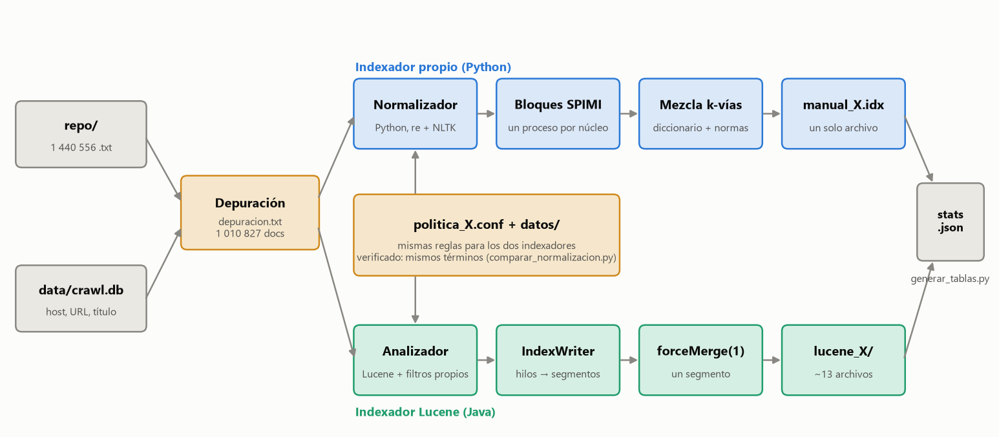
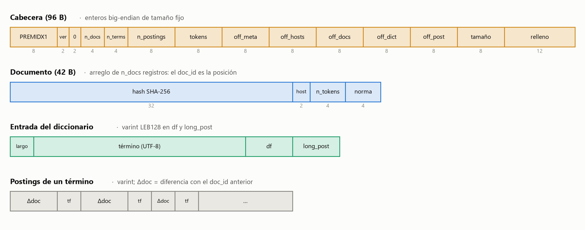
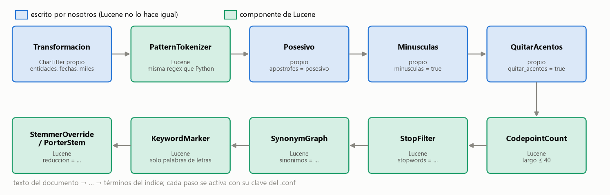

<div align="center">

**Instituto Tecnológico de Costa Rica**  
Escuela de Ingeniería en Computación  
IC8060 – Recuperación de Información Textual  
II Semestre, 2026

# ThePremArchive
### Sistema de Recuperación de Información sobre la Premier League
**Proyecto 2 – Construcción de Índices de Búsqueda**


**Profesor:** Aurelio Sanabria Rodríguez

**Integrantes:**  
Daniel de Jesús Alemán Ruiz – 2023051957  
Sebastián Rodríguez Sánchez – 2023074446  

**Fecha de entrega:** Octubre, 2026

</div>

---

## 1. Introducción

Con el arañador del primer proyecto juntamos 1 440 556 documentos de texto plano sobre la Premier League, unos 16 GB. Ahora toca poder buscar en ellos: construir un índice TF-IDF para encontrar los documentos más parecidos a una consulta sin tener que leer toda la colección cada vez.

Lo hacemos de dos maneras, como pide el enunciado. Una es un indexador escrito por nosotros, que guarda el índice en un archivo binario con un formato propio. La otra es con Apache Lucene, usando las mismas políticas de normalización para poder comparar los dos. Las prioridades del enunciado son un índice pequeño y un tiempo de indexación corto, así que cada vez que tuvimos que elegir entre dos opciones nos fijamos en eso y, cuando se pudo, decidimos con datos de nuestra propia colección.

Los dos indexadores son programas aparte de la araña y leen exactamente los mismos archivos de configuración, así que cualquier diferencia entre sus índices viene de cómo están construidos y no de qué indexan:



*Figura 1. De la colección a los dos índices. La política (archivo `.conf` y listas de `datos/`) es la misma para ambos.*

## 2. Primero, mirar qué teníamos

Antes de normalizar nada revisamos la colección, y lo que vimos nos hizo cambiar el plan. Daily Mail es el 13 % de los documentos, pero sus páginas son muy largas y ocupan el **62 % de todo el texto**. Además, solo el 7 % de esas páginas es de fútbol. El resto son sucesos, política y noticias generales. Algo parecido, aunque en menor medida, pasa con las secciones locales de otros diarios.

Lo primero que probamos para limpiar fue usar el conteo de palabras clave de fútbol que la araña dejó guardado en cada documento (`topic_hits`). No funcionó. Las páginas del Daily Mail traen titulares de fútbol en los costados, así que sacan buen puntaje aunque el artículo sea de otra cosa, y al revés, notas cortas y buenas sobre un partido quedaban por debajo del mínimo. Lo probamos en una muestra, vimos que se equivocaba para los dos lados y lo dejamos como un experimento descartado.

Lo que sí funcionó fue una regla más simple, basada en el sitio y en la URL. Los sitios especializados en fútbol (Goal, Transfermarkt, Football365 y otros) entran completos. En los sitios generalistas solo entran las páginas cuya URL o título indican que son de fútbol. Las reglas están en un archivo de texto aparte y son las mismas para todas las políticas, así que la comparación entre ellas sigue siendo justa.

Con esto nos quedamos con 1 010 827 documentos (el 70 %), pero con solo 5.1 GB de texto de los 16.2 GB (el 31 %). En una muestra de 3 000 documentos, el índice de la política más simple pasó de 4.9 MB a 2.0 MB.

Tiene un costo que preferimos decir claro. Probamos 15 consultas de fútbol y 6 de los 150 resultados del top 10 del índice sin depurar quedaron fuera. Son páginas de jugadoras y jugadores poco conocidos, sobre todo del fútbol femenino, que casi no mencionan palabras clave del dominio. Es un sesgo real de la regla. Decidimos aceptarlo a cambio de un índice mucho más pequeño, aunque todavía no medimos cuánto baja el tiempo de indexación.

## 3. Políticas de normalización

Armamos seis políticas. Tres son las que entregamos (A, B y C), y cada una agrega más cuidado a la anterior. Las otras tres cambian **una sola cosa** respecto a alguna de las anteriores, para ver qué efecto tiene esa decisión sin que se mezcle con otras.

| Paso de normalización | A | B | C | D | E | F |
|---|:---:|:---:|:---:|:---:|:---:|:---:|
| Minúsculas y separar en palabras | ✔ | ✔ | ✔ | ✔ | ✔ | ✔ |
| Posesivos (`Arsenal's` → `arsenal`) | — | ✔ | ✔ | — | ✔ | ✔ |
| Quitar acentos (`Atlético` → `atletico`) | — | ✔ | ✔ | — | ✔ | ✔ |
| Stopwords | — | ✔ | ✔ | ✔ | ✔ | ✔ |
| Fechas y números (`May 6, 2010` → `2010-05-06`) | — | ✔ | ✔ | — | ✔ | ✔ |
| Sinónimos (`soccer` → `football`) | — | — | ✔ | — | ✔ | ✔ |
| Clubes y competiciones (`Man City` → `manchester_city`) | — | — | ✔ | — | ✔ | — |
| Reducción de palabras | — | — | lemas | — | Porter | — |
| **Para qué sirve** | base | entrega | entrega | efecto de las stopwords | stemming contra lemas | efecto de los sinónimos |

Estas son las decisiones y por qué las tomamos:

- **Posesivos.** Si se separa en el apóstrofe, `Arsenal's` deja una `s` suelta, y por eso la `s` aparecía entre las palabras más frecuentes de toda la colección. En B y C se elimina el posesivo y `Arsenal's` queda como `arsenal`.
- **Stopwords.** Partimos de la lista en inglés de NLTK [4], porque la colección está en inglés, y le hicimos varios ajustes. Le quitamos `won` (aparece ahí por venir de "won't", pero en fútbol es una palabra clave) y también `will` y `can`, que además de verbos son nombres de jugadores (Will Hughes, Will Keane, Emre Can): con la lista original, buscar `Will Keane goals` se reducía a `keane goals` y el primer resultado era Michael Keane. Tampoco incluimos `may`, que es el verbo pero también el mes de mayo. Conservar estas tres palabras casi no cuesta nada, porque juntas son el 0.41 % de los postings del índice. En cambio, agregamos los fragmentos que deja separar apóstrofes (`s`, `t`, …) y unos cuantos verbos modales (`could`, `would`, `might`, `must`, `shall`) y el adverbio `also`. Al final son 159 palabras. Revisamos además que ningún país esté en la lista.
- **Lematización y stemming.** Para lematizar usamos WordNet [3] a través de NLTK, pero comete errores en este dominio: por ejemplo, reducía `boss` a `bos` y `wedding` a `wed`. Por eso solo aceptamos reducciones por sufijos regulares, excluimos unas pocas palabras problemáticas y protegimos nombres de clubes escritos en minúscula (`united`, `wolves`, `spurs`). Solo lematizamos palabras que aparecen al menos 20 veces, lo que deja 21 591 reglas. En la política E comparamos contra el algoritmo de Porter [2], en la versión de referencia de su autor, que es la misma que trae Lucene (ver sección 7).
- **Sinónimos.** Mantuvimos la lista corta a propósito: `soccer` con `football`, `goalie` con `goalkeeper`, `ref` con `referee` y poco más. Descartamos pares como `manager` y `coach`, o `loss` y `defeat`, porque en estas noticias no significan lo mismo.
- **Fechas y números.** Las fechas en formatos como `May 6, 2010` o `6/5/2010` pasan a `2010-05-06`. A los números se les quitan los separadores de miles (`1,234` queda en `1234`), para que cuenten como un solo término. Tiene límites que conocemos: no convertimos las fechas con puntos (`11.03.2023`) ni con año de dos dígitos (`09/05/26`), ni las que no traen año (`June 10`), y las del tipo `03/05/2025` las leemos como día/mes (el uso británico), que en fuentes estadounidenses podría significar marzo 5.
- **Clubes y competiciones.** Un archivo con los clubes de la Premier League y las competiciones principales, con sus alias, hace que `Man City`, `man city` y `Manchester City` terminen siendo un solo término (`manchester_city`), y lo mismo con `Premier League` o `World Cup`. Lo importante es que esto funciona igual escrito en mayúsculas o en minúsculas, porque la gente busca en minúsculas. Dejamos afuera a propósito apodos ambiguos como `Citizens` o `Magpies`, que también significan otras cosas. Nuestra primera versión unía cualquier secuencia de palabras con mayúscula (`Kaizer Chiefs`, `Harry Kane`), pero la descartamos al evaluarla: se explica en la sección de evaluación.

El balance de cada decisión, con lo que medimos en las secciones 5 y 6:

| Decisión | Ventaja | Desventaja | Lo que medimos |
|---|---|---|---|
| Stopwords | Quita las palabras con las listas de postings más largas | Se pierden consultas hechas solo de stopwords y nombres como *Will* o *Can*, si no se cuidan | -13 % de tamaño (D contra A); el acierto no baja (0.53 contra 0.50) |
| Posesivos | `Arsenal's` y `arsenal` son el mismo término; desaparece la `s` suelta | Formas como `O'Neil` quedan como `oneil` | La `s` estaba entre las palabras más frecuentes de la colección |
| Fechas y números | Una fecha escrita de varias formas da un solo término | Formatos no cubiertos y ambigüedad día/mes (sección 3) | Con fechas normalizadas (B, C, E, F) el documento de la consulta de fechas sale primero; sin ellas (A, D), no |
| Lematización | Une plural y singular con palabras reales (`injuries` → `injury`) | Hace coincidir texto de plantilla y depende de una lista que hay que revisar | Índice 6 % más pequeño que B, pero acierto 0.42 contra 0.53 |
| Stemming (Porter) | No necesita lista, es determinista y viene en Lucene | Produce raíces que no son palabras (`news` → `new`) y une palabras distintas | 7 % menos términos que la lematización; casi el mismo tamaño y acierto (0.41 contra 0.42) |
| Sinónimos | Una consulta con `soccer` encuentra documentos con `football` | Con una lista larga mete ruido; por eso es corta | Sin efecto medible en tamaño (F contra B); acierto 0.51 contra 0.53 |
| Clubes y competiciones | `man city` y `Manchester City` se buscan igual | Hay que mantener la lista de alias a mano | Vocabulario de 1.95 M a 0.90 M términos frente a la versión por mayúsculas |

## 4. El índice propio

El índice sigue el modelo vectorial. Cada documento es una lista de pesos, uno por término. El peso sube con las veces que el término aparece en el documento (tf) y baja cuanto más documentos lo contienen (idf). La consulta se convierte en una lista igual, y se compara con cada documento usando el coseno [1].

Para no cargar toda la colección en memoria, usamos la idea de SPIMI [5]. Varios procesos leen y normalizan los documentos en paralelo, cada uno guarda pequeños índices ordenados en bloques, y al final los bloques se mezclan en uno solo. Como construir los seis índices de la colección completa lleva cerca de una hora, el proceso guarda su avance: cada bloque se escribe primero con un nombre temporal y se renombra solo cuando está completo, así que si se corta la luz o se cierra el programa, al volver a ejecutarlo continúa donde se quedó. Lo comprobamos matando el proceso a la fuerza varias veces y verificando que el índice final sale idéntico byte a byte al de una ejecución sin interrupciones.

### 4.1 Cómo está organizado el archivo

Todo queda en un único archivo, con las partes una detrás de otra:

```text
+----------+-----------+--------+------------+-------------+------------+
| Cabecera | Metadatos | Hosts  | Documentos | Diccionario | Postings   |
| 96 bytes | config    | sitios | uno por    | términos    | documentos |
|          |           |        | documento  | ordenados   | por término|
+----------+-----------+--------+------------+-------------+------------+
```

| Parte | Qué guarda |
|---|---|
| **Cabecera** | Una marca de formato (`PREMIDX1`), la versión, cuántos documentos y términos hay, y en qué posición del archivo empieza cada parte. |
| **Metadatos** | El archivo de configuración con que se construyó el índice, para que el propio archivo diga de qué política viene. |
| **Hosts** | La lista de sitios de origen, para no repetir su nombre en cada documento. |
| **Documentos** | Un registro de tamaño fijo por documento (42 bytes): su hash, su sitio, cuántas palabras tiene y su norma, que se usa para calcular el coseno. |
| **Diccionario** | Todos los términos en orden. Cada uno guarda en cuántos documentos aparece y cuánto ocupan sus postings. |
| **Postings** | Para cada término, los documentos donde aparece y cuántas veces. |

Para que el archivo ocupe poco, en las postings no se guarda el número de cada documento completo sino la diferencia con el anterior, y los enteros se escriben con los bytes justos (los menores de 128 ocupan uno solo). Los números de tamaño fijo van en *big-endian*, que es el orden en que uno los lee de corrido en un volcado hexadecimal. Así empieza un índice de prueba de 3 000 documentos visto con `hexdump -C`:

```text
00000000  50 52 45 4d 49 44 58 31  00 01 00 00 00 00 0b b8  |PREMIDX1........|
00000010  00 01 69 00 00 00 00 00  00 1c 61 40 00 00 00 00  |..i.......a@....|
```

- `50 52 45 4d 49 44 58 31` es la marca `PREMIDX1`.
- `00 01` es la versión del formato (1), seguida de dos bytes reservados en cero.
- `00 00 0b b8` es el número de documentos: 3 000.
- `00 01 69 00` es el número de términos distintos: 92 416.
- `00 00 00 00 00 1c 61 40` es el número de postings: 1 860 928.

### 4.2 Campo por campo



*Figura 2. Campos de cada parte del archivo; los números bajo los campos fijos son su tamaño en bytes.*

La cabecera guarda dónde empieza cada parte, así que no hace falta recorrer el archivo para llegar a una de ellas. `info` imprime esas posiciones, y con ellas `hexdump` salta directo:

```bash
python -m indexacion.indexador_manual info indices/manual_A.idx          # ... diccionario@<D> postings@<P>
hexdump -C -s <D> -n 64 indices/manual_A.idx                              # primeras entradas del diccionario
```

Las partes de tamaño variable usan *varint* (LEB128 [11]): cada byte aporta 7 bits del número y su bit más alto indica si sigue otro byte. Un ejemplo construido a mano: si `arsenal` aparece en los documentos 5, 9 y 140, con frecuencias 2, 1 y 3, se guarda así:

| Parte | Bytes | Cómo se lee |
|---|---|---|
| Diccionario | `07` | el término mide 7 bytes |
| | `61 72 73 65 6e 61 6c` | `arsenal` en UTF-8 |
| | `03` | df = 3 documentos |
| | `07` | sus postings ocupan 7 bytes |
| Postings | `05 02` | documento 5, tf 2 |
| | `04 01` | documento 5 + 4 = 9, tf 1 |
| | `83 01 03` | `83 01` = 3 + 1·128 = 131, documento 9 + 131 = 140; tf 3 |

Guardar diferencias en lugar de números de documento es lo que hace pequeñas las postings: en un término frecuente los documentos están cerca unos de otros, las diferencias son chicas y casi todas caben en un byte. Por eso el índice completo usa 2.3 bytes por posting (Tabla 1), aunque el número de documento por sí solo necesitaría 3.

El peso de un término en un documento es `(1 + log₁₀ tf) · log₁₀(N / df)`, y cada documento guarda la norma de su vector, calculada al terminar con los `df` definitivos. Al buscar, la consulta se pesa igual y el puntaje es el coseno entre los dos vectores; es el esquema *ltc.ltc* de la notación SMART [1][12].

## 5. ¿Qué tan buenos son los resultados?

El tamaño y el tiempo no lo dicen todo: un índice pequeño no sirve de nada si no encuentra lo que uno busca. Para medir la calidad armamos 12 consultas de fútbol, cada una pensada para poner a prueba una de nuestras decisiones (`man city vs man utd` para los alias de clubes, `soccer transfer deadline day` para los sinónimos, `premier league results 5 May 2012` para las fechas, y así). Corrimos cada consulta en los seis índices y juntamos los 10 primeros resultados de cada política, sin repetir documentos, que es el método del *pool* [1]. Quedaron 247 documentos distintos para marcar como relevantes o no.

Las marcas las propuso una IA con un único criterio, *¿le serviría este artículo a quien escribió esa búsqueda?*, y Daniel las revisó [confirmar tras la revisión]. Los 28 casos donde el criterio era discutible quedaron señalados aparte para revisarlos con más cuidado. Con eso calculamos, para cada política, qué parte de sus 10 primeros resultados era relevante.

Una aclaración sobre las versiones: la primera medición (5.1) se hizo con una lista de stopwords que todavía incluía `will`, `can` y `may`. Después las quitamos (ver la sección 3), reconstruimos los índices y repetimos la evaluación: los promedios casi no se movieron (B subió de 0.52 a 0.53 y F de 0.50 a 0.51; las demás políticas quedaron igual), así que las conclusiones no cambian. Los números que se citan a partir de 5.2 ya son los de la lista nueva.

### 5.1 Primera medición

| Política | Acierto promedio en los 10 primeros resultados |
|---|:---:|
| A | 0.50 |
| B | 0.52 |
| C | 0.40 |
| D | 0.53 |
| E | 0.38 |
| F | 0.50 |

Las políticas simples (A, B, D y F) quedaron parecidas, y las dos más elaboradas (C y E) salieron claramente peores, lo contrario de lo que esperábamos. En `players scoring goals this season`, por ejemplo, pasaron de 0.8 a 0.2, y en `world cup england squad` de 0.5 a 0.0.

Al revisar la causa, el problema era nuestro. En C y E uníamos en un solo término cualquier secuencia de palabras con mayúscula, así que un documento que decía "World Cup" quedaba indexado como `world_cup`. Pero las personas escriben sus búsquedas en minúsculas, y `world cup` en una consulta se convertía en dos términos, `world` y `cup`, que no aparecían tal cual en ese documento. Los índices tenían la información, pero la consulta no podía encontrarla. En el mismo documento "England's World Cup" llegó a quedar como `englands_world_cup`, otro síntoma de lo mismo.

Hubo algo que sí salió bien: la consulta de fechas tiene un único documento relevante (*Arsenal 3-3 Norwich City, 5 de mayo de 2012*), y lo encontraron en el primer puesto las políticas que normalizan fechas (B, C, E y F) pero no las que no lo hacen (A y D).

### 5.2 Corrección y segunda medición

Para arreglarlo cambiamos la regla: en vez de unir cualquier secuencia con mayúscula, C y E solo unen los nombres de una lista de clubes y competiciones, y esa lista se reconoce igual en mayúsculas y en minúsculas. Así la consulta y el documento producen el mismo término (`world_cup`, `premier_league`, `manchester_city`). Reconstruimos los índices C y E y repetimos la evaluación, reutilizando las marcas anteriores y juzgando solo los 30 documentos nuevos.

| Política | Antes | Después |
|---|:---:|:---:|
| C | 0.40 | 0.42 |
| E | 0.38 | 0.41 |

El arreglo ayudó, pero poco: C y E siguen por debajo de B y D (ambas 0.53). Lo que sí cambió mucho es el índice: el vocabulario de C bajó de 1 951 097 a 895 077 términos (el tamaño casi no cambió, de 656 MB a 655 MB), porque ya no se crean cientos de miles de nombres que aparecían una sola vez.

Para entender lo que quedaba miramos la consulta `liverpool injury news`, donde B acierta 0.3 y C 0.0. La consulta se normaliza igual en las dos, pero C sube a los primeros puestos unas páginas de partido de Goal.com ("Liverpool v Chelsea | Goal.com"). Al abrirlas, lo único que dicen sobre lesiones es el encabezado de su plantilla: *"Injuries and Suspensions: No sidelined players"*, es decir, que no hay ninguna. Como C lematiza, `injuries` pasa a ser `injury` y esas páginas, que son cortas y repetitivas, empiezan a coincidir con la búsqueda. B no las encuentra porque no une `injuries` con `injury`.

Es un resultado que no esperábamos y que nos pareció valioso: la lematización une formas de una palabra, que en general ayuda, pero también hace coincidir texto de plantilla de páginas que no tratan del tema. En este corpus, con muchas páginas automáticas y cortas, esa ventaja no alcanza a compensar. La lección que nos dejó el episodio es que cualquier transformación aplicada al texto de los documentos debe aplicarse igual a la consulta, y que una mejora de normalización solo se puede dar por buena si se mide con búsquedas reales.

## 6. Estadísticas de los índices

Como son seis políticas y dos indexadores, organizamos las estadísticas en cuatro tablas: dos que describen cada indexador por separado, una que los compara, y una que mide qué cambia cada decisión de normalización. Todas las cifras son sobre la colección ya depurada (1 010 827 documentos); la política A no usa stopwords, así que no cambia con los ajustes de la lista.

**Tabla 1. Indexador propio**

| Política | Documentos | Tokens | Términos | Postings | Tamaño | Bytes/posting | Tiempo |
|---|---|---|---|---|---|---|---|
| A (base) | 1 010 827 | 900 360 645 | 847 186 | 353 851 101 | 796.6 MB | 2.25 | 4 min 47 s |
| B | 1 010 827 | 602 639 609 | 914 776 | 301 803 452 | 695.4 MB | 2.30 | 9 min 26 s |
| C | 1 010 827 | 591 966 960 | 895 077 | 284 645 213 | 655.2 MB | 2.30 | 11 min 20 s |
| D (A + stopwords) | 1 010 827 | 609 442 978 | 847 027 | 300 254 717 | 689.3 MB | 2.30 | 6 min 47 s |
| E (C con stemming) | 1 010 827 | 591 966 960 | 830 404 | 281 240 444 | 645.0 MB | 2.29 | 11 min 54 s |
| F (B + sinónimos) | 1 010 827 | 602 639 609 | 914 769 | 301 555 105 | 694.9 MB | 2.30 | 9 min 53 s |

Los tiempos de esta tabla son una primera medición: hubo ruido (por ejemplo, D salió bastante más lenta que A aunque hace casi el mismo trabajo), así que los vamos a repetir con el equipo en reposo y en el mismo orden antes de usarlos para comparar.

**Tabla 2. Indexador con Lucene**

<!-- Pegar aquí la Tabla 2 que imprime: python indexacion/herramientas/generar_tablas.py -->

**Tabla 3. Indexador propio contra Lucene (razón = Lucene / propio)**

<!-- Pegar aquí la Tabla 3 que imprime: python indexacion/herramientas/generar_tablas.py -->


*Figura 3. Tamaño y tiempo de indexación por política. Las columnas de documentos, tokens, términos y postings de las Tablas 1 y 2 son iguales, porque los dos indexadores producen exactamente los mismos términos (sección 7); lo único que cambia es cómo los guardan.*

**Tabla 4. Efecto de cada decisión (indexador propio, cambio respecto a la segunda política de cada fila)**

| Comparación | Qué se mide | Términos | Postings | Tamaño | Tiempo |
|---|---|---|---|---|---|
| D contra A | efecto de las stopwords | ≈ 0 % | -15 % | -13 % | pendiente |
| E contra C | stemming contra lematización | -7 % | -1 % | -2 % | pendiente |
| F contra B | efecto de los sinónimos | ≈ 0 % | ≈ 0 % | ≈ 0 % | pendiente |
| A contra sin depuración | efecto de depurar la colección | -35 % | -64 % | -62 % | -65 % |

El balance de cada decisión de normalización ya está resumido en la tabla del final de la sección 3. La que más pesa no es de normalización: **depurar la colección** baja el índice de 2.10 GB a 0.80 GB (62 % menos) y el tiempo de indexación de 13.7 a 4.8 minutos (65 % menos).

## 7. Indexador con Apache Lucene

Es un programa en Java (`indexacion/indexador_lucene/`) sobre Lucene 9.12. Está en Java porque Lucene es una biblioteca de Java: desde Python solo se puede usar a través de puentes (PyLucene, JPype), que complican la instalación y, en el caso de JPype, no permiten heredar de las clases de Lucene para escribir los filtros propios que necesitamos (sección 7.2). Lee el mismo `.conf` que el indexador propio, aplica la misma depuración e indexa los mismos documentos.

### 7.1 Decisiones

| Decisión | Elección | Por qué |
|---|---|---|
| Versión | Lucene 9.12.3 | Lucene 10 exige Java 21 y el equipo tiene Java 17 |
| Qué se guarda del texto | Solo documentos y frecuencias (`DOCS_AND_FREQS`) | El modelo vectorial solo necesita el tf; las posiciones agrandan el índice y sirven para búsquedas por frase, que no hacemos [6] |
| Campos guardados | Hash (32 bytes) y sitio, con `BEST_COMPRESSION` | Lo mínimo para mostrar un resultado, igual que el registro de 42 bytes del índice propio |
| Modelo de puntaje | `ClassicSimilarity` | Es la implementación del modelo vectorial TF-IDF en Lucene; la que trae por omisión (BM25) es un modelo probabilístico [7] |
| Archivos compuestos | Desactivados | Así cada estructura queda en su propio archivo y se puede medir su tamaño |
| Paralelismo | Varios hilos sobre un mismo `IndexWriter` | `IndexWriter` admite hilos concurrentes: cada uno arma su propio segmento en memoria [9] |
| Al terminar | `forceMerge(1)` | Deja un solo segmento, comparable con el archivo único del índice propio; su tiempo se mide aparte |

### 7.2 Las mismas políticas en Lucene

Lucene arma los términos con una cadena de análisis: un `CharFilter` que trabaja sobre el texto completo, un tokenizador y una serie de filtros de tokens. Usamos los componentes de Lucene donde se comportan igual que nuestra normalización en Python, y escribimos los nuestros donde no:



*Figura 4. Cadena de análisis. Cada paso se activa con la misma clave del `.conf` que en el indexador propio.*

| Paso | Componente de Lucene disponible | Por qué no alcanzaba |
|---|---|---|
| Fechas, miles y entidades | `PatternReplaceCharFilter` | Solo reemplaza por un texto fijo; una fecha necesita convertir el nombre del mes en número |
| Posesivos | `EnglishPossessiveFilter` | Quita `'s` pero deja los apóstrofes internos (`O'Neil`) |
| Minúsculas | `LowerCaseFilter` | Convierte carácter por carácter: `İ` queda `i`, y en Python queda `i̇` |
| Acentos | `ASCIIFoldingFilter` | Además cambia `ß` → `ss` y `æ` → `ae`, cosa que Python no hace |

Para comprobar que los dos indexadores producen lo mismo escribimos `comparar_normalizacion.py`. Toma documentos, los normaliza con los dos y compara la lista de términos de cada uno, en orden. La comparación encontró una diferencia que no esperábamos: el `PorterStemmer` de NLTK trae por omisión reglas propias (deja `news` como `news`, mientras que el original da `new`), así que cambiamos el indexador propio a la versión de referencia de Porter, que es la que usa Lucene, y reconstruimos el índice E.

| Prueba | Resultado |
|---|---|
| 3 000 documentos de prueba con los casos difíciles (fechas, posesivos, acentos, `İstanbul`, alias de clubes, bytes inválidos), seis políticas | 100 % de documentos con los mismos términos |
| Vocabulario completo de la colección (996 322 palabras), con stemming y con lematización | 100 % iguales |
| Índices construidos con la muestra de prueba (A, C y E) | Mismos documentos, tokens, términos y postings |
| Colección real, [N] documentos por política | [pendiente] |

## 8. Comparación entre los dos indexadores

Como los dos índices contienen exactamente los mismos términos y las mismas postings, las diferencias de la Tabla 3 vienen solo de cómo cada uno los guarda y los construye:

| Aspecto | Indexador propio | Lucene | Ventaja / desventaja |
|---|---|---|---|
| Archivos | Uno solo (`.idx`) con secciones | Un segmento repartido en una docena de archivos, uno por estructura | El propio es más fácil de inspeccionar con `hexdump`; los segmentos de Lucene no se modifican nunca, así que se pueden agregar documentos sin reconstruir el índice |
| Diccionario | Lista ordenada de entradas completas, que se carga entera al abrir el índice | Términos en bloques que comparten prefijo (`.tim`) y un índice de prefijos en forma de autómata, FST (`.tip`) [8] | Lucene no repite prefijos y encuentra un término sin cargar todo el diccionario; el propio es más simple de escribir y de leer |
| Postings | Pares varint (salto de documento, tf), uno detrás de otro | Bloques de 128 saltos y 128 frecuencias empaquetados con el mínimo de bits (FOR/PFOR), el resto en varint, y datos para saltar bloques [6][10] | El empaquetado por bloques comprime más y se decodifica más rápido; con varint cada número ocupa al menos un byte entero |
| Peso del término | `(1 + log₁₀ tf) · log₁₀(N/df)` | `√tf · (1 + ln((N+1)/(df+1)))` [7] | Las dos atenúan el tf y premian los términos raros; la de Lucene nunca da idf cero |
| Normalización del documento | Norma coseno exacta, 4 bytes por documento, calculada al final con los df definitivos | `1/√largo`, aproximada en 1 byte por documento y calculada al indexar cada documento [7] | La del propio es exacta pero necesita conocer toda la colección; la de Lucene se puede calcular documento por documento |
| Construcción | Procesos (no hilos, por el GIL de Python) que escriben bloques ordenados; al final se mezclan (SPIMI) | Hilos que llenan segmentos en memoria y los escriben; luego se fusionan | Las dos ideas son la misma: armar partes pequeñas y mezclarlas |
| Si se interrumpe | Continúa donde quedó | Se vuelve a empezar (solo conserva el último *commit*) | Nuestra reanudación sirvió en la práctica, con indexaciones largas en un equipo de escritorio |
| Integridad | Sin verificación | Cada archivo lleva cabecera y suma de verificación (CRC32) | Lucene detecta un archivo dañado; el propio no |

<!-- Cuando estén los números reales, agregar aquí 3 o 4 viñetas que lean la Tabla 3 y la Figura 3, por ejemplo:
- Tamaño: Lucene ocupa X veces lo del propio; la diferencia está casi toda en las postings (.doc) por el empaquetado en bloques.
- Tiempo: ...
- Desglose por archivo de lucene_C.stats.json (tamano_por_extension): postings X %, diccionario Y %, normas Z %, campos guardados W %. -->

## Referencias

1. Manning, C. D., Raghavan, P. y Schütze, H. (2008). *Introduction to Information Retrieval*. Cambridge University Press.
2. Porter, M. F. (1980). An algorithm for suffix stripping. *Program, 14*(3), 130–137.
3. Fellbaum, C. (ed.) (1998). *WordNet: An Electronic Lexical Database*. MIT Press.
4. Bird, S., Klein, E. y Loper, E. (2009). *Natural Language Processing with Python*. O'Reilly.
5. Heinz, S. y Zobel, J. (2003). Efficient single-pass index construction for text databases. *Journal of the American Society for Information Science and Technology, 54*(8), 713–729.
6. Apache Software Foundation (2024). *Lucene912PostingsFormat* (documentación de Apache Lucene 9.12). https://lucene.apache.org/core/9_12_0/core/org/apache/lucene/codecs/lucene912/Lucene912PostingsFormat.html
7. Apache Software Foundation (2024). *TFIDFSimilarity* y *ClassicSimilarity* (documentación de Apache Lucene 9.12). https://lucene.apache.org/core/9_12_0/core/org/apache/lucene/search/similarities/TFIDFSimilarity.html
8. Apache Software Foundation (2024). *Lucene90BlockTreeTermsWriter* (documentación de Apache Lucene 9.12). https://lucene.apache.org/core/9_12_0/core/org/apache/lucene/codecs/lucene90/blocktree/Lucene90BlockTreeTermsWriter.html
9. Apache Software Foundation (2024). *IndexWriter* (documentación de Apache Lucene 9.12). https://lucene.apache.org/core/9_12_0/core/org/apache/lucene/index/IndexWriter.html
10. Lemire, D. y Boytsov, L. (2015). Decoding billions of integers per second through vectorization. *Software: Practice and Experience, 45*(1), 1–29.
11. DWARF Debugging Information Format Committee (2017). *DWARF Debugging Information Format, Version 5*, sección 7.6 (codificación LEB128).
12. Salton, G. y Buckley, C. (1988). Term-weighting approaches in automatic text retrieval. *Information Processing & Management, 24*(5), 513–523.
